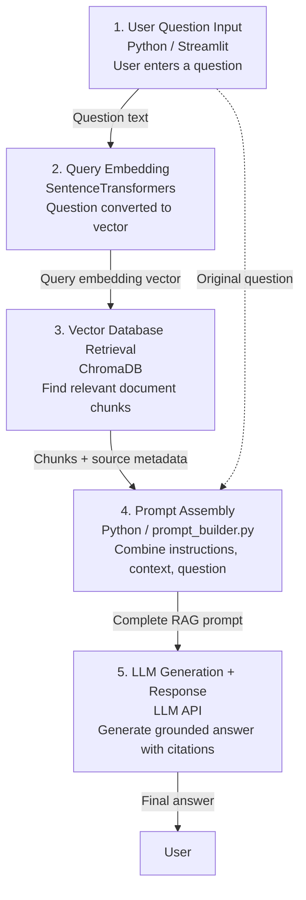

# RAG Pipeline Architecture

## Five-Stage RAG Pipeline

## Stage Descriptions

1. **User Question Input**
   - Technology: Python / Streamlit
   - Action: Accept a natural-language question
   - Output: Question text

2. **Query Embedding**
   - Technology: SentenceTransformers
   - Action: Convert the question into a numerical vector
   - Output: Query embedding

3. **Vector Database Retrieval**
   - Technology: ChromaDB
   - Action: Search for semantically relevant chunks
   - Output: Chunk text, source metadata, distances

4. **Prompt Assembly**
   - Technology: Python / prompt_builder.py
   - Action: Combine system prompt, retrieved context,
     source labels, and original user question
   - Output: Complete RAG prompt

5. **LLM Generation + Response**
   - Technology: Language model / LLM API
   - Action: Generate an answer using the supplied context
   - Output: Answer with source citations

## Implementation Notes

- The query and document embeddings must use compatible
  embedding models.
- ChromaDB retrieves relevant information but does not
  generate the final answer.
- The prompt builder prepares the prompt but does not
  call the LLM.
- The current assignment simulates retrieved chunks.
- Token estimates use len(prompt) // 4.

## Test Results

| Test | Characters | Estimated Tokens |
|---|---:|---:|
| FastAPI validation | 610 | 152 |
| ChromaDB semantic search | 659 | 164 |

Both tests passed.

